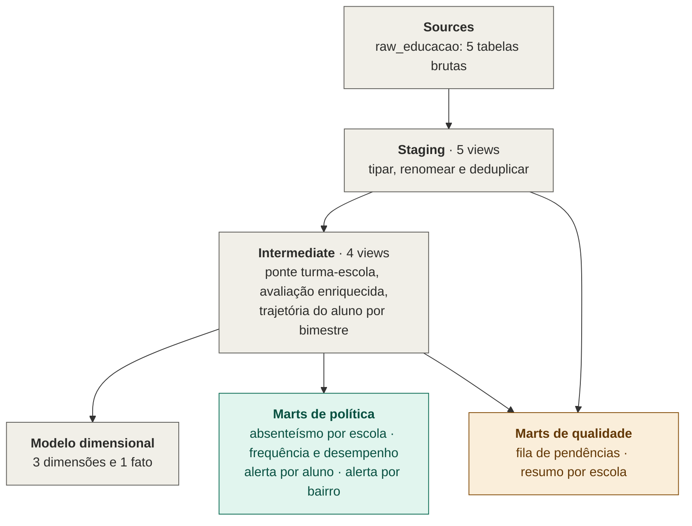
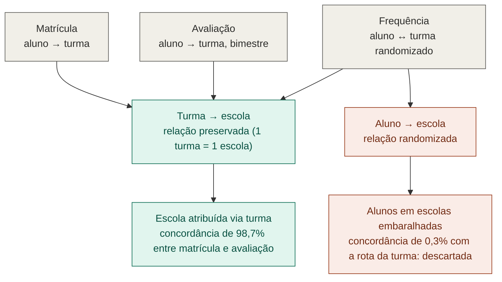

# Absenteísmo escolar e busca ativa na rede municipal do Rio: um projeto dbt orientado à gestão

**Desafio Técnico: Cientista de Dados, Registro Municipal Integrado (RMI), Prefeitura do Rio de Janeiro**
Autor: Júlio Cesar dos Santos. Enunciado original: [prefeitura-rio/desafio-cientista-dados-peqc](https://github.com/prefeitura-rio/desafio-cientista-dados-peqc)

---

## Objetivo e foco

O desafio pede um projeto dbt-core + dbt-bigquery sobre dados educacionais anonimizados,
organizado em camadas, com estratégia de testes, SQL analítico e documentação que permita
reproduzir o trabalho.

Este projeto usa o dbt para modelar esses dados com foco no **absenteísmo escolar** e na
**política de busca ativa**, em duas frentes. A primeira entrega produtos para a decisão de
política pública: quais alunos procurar, em quais escolas e bairros concentrar o esforço e
quais limites de frequência fazem sentido nesta rede, com regras baseadas na legislação
nacional e nas normas da Secretaria Municipal de Educação do Rio (SME-Rio). A segunda entrega
um produto de gestão da qualidade do dado: uma fila de pendências que transforma os problemas
encontrados pelos testes em tarefas com responsável, para que sejam corrigidos na origem.

### Principais resultados

- **19 modelos** em três camadas, com contracts nos 10 marts, testes genéricos e singulares,
  unit tests das regras de alerta e um teste customizado que valida as chaves entre tabelas a
  cada build.
- **Na tabela de frequência, a relação entre aluno e turma foi randomizada**: só 0,01% dos
  pares existem na matrícula. Por isso a escola é atribuída apenas pela turma e fica nula
  quando não pode ser identificada, em vez de receber uma escola errada.
- **Quanto menor a frequência, maior a chance de nota baixa, de forma contínua**: cada 5
  pontos a menos de frequência somam cerca de 8 pontos na chance de nota baixa. Os cortes de
  85% e 75% das normas do Rio coincidem com 1,5 e 2 vezes o risco.
- **A regra legal das 15 faltas não basta para priorizar**: no 4º bimestre ela atinge 52% dos
  alunos avaliados. Os níveis de alerta dizem por onde começar.
- **17.729 pendências de qualidade** organizadas por tipo, dimensão de qualidade e
  responsável.

---

## Estrutura do repositório

```
├── dbt_project.yml            # camadas, materializações e limites de política (vars)
├── packages.yml / package-lock.yml
├── requirements.txt
├── eda/                       # análise exploratória (DuckDB) com as saídas versionadas
├── models/
│   ├── staging/educacao/      # 5 stagings, sources e testes
│   ├── intermediate/educacao/ # joins e regras de negócio
│   └── marts/educacao/        # 3 dimensões, 1 fato, 6 marts temáticos, contracts e unit tests
└── tests/
    ├── assert_*.sql           # regras educacionais (testes singulares)
    └── generic/test_concordancia_minima.sql
```

---

## Para quem e para quê

| Modelo | Quem usa | Decisão que apoia | Base normativa |
|---|---|---|---|
| `mart_educacao__alerta_precoce_aluno_bimestre` | direção da escola, Agente de Frequência, CIPE | quem procurar, com quem fazer atendimento, quem comunicar ao Conselho Tutelar | LDB art. 12, VII e VIII, e art. 24, VI; ECA art. 56, II; Circulares E/SUBAIR 02, 05 e 13/2026 |
| `mart_educacao__alerta_bairro_bimestre` | equipes de busca ativa e parceiros territoriais | em quais bairros concentrar a busca ativa | CF art. 205; LDB art. 12, VI; Circular E/SUBAIR 02/2026 |
| `mart_educacao__absenteismo_escola_bimestre` | Coordenadorias Regionais (CRE) | quais escolas acompanhar no próximo bimestre | Decreto Rio 50.862/2022 (Bora pra Escola) |
| `mart_educacao__frequencia_desempenho` | planejamento | se os cortes de 75% e 85% marcam piora nesta rede | Circulares E/SUBAIR 05 e 13/2026 |
| `mart_educacao__pendencias_qualidade` e `_escola` | Secretaria, que distribui às escolas | o que corrigir na origem e por onde começar | LDB art. 24, VI (registro de frequência a cargo da escola) |

A busca ativa também é territorial. A Constituição define a educação como dever do Estado e
da família, com a colaboração da sociedade (art. 205), e a Circular E/SUBAIR 02/2026 orienta
as escolas a planejar a busca ativa com o Conselho Escola-Comunidade, lideranças locais,
associações de moradores e Conselhos Tutelares. O mart por bairro mostra onde concentrar
essa rede.

---

## Arquitetura



O lineage completo, modelo a modelo, está no `dbt docs` (`dbt docs generate && dbt docs serve`).

| Camada | Materialização | Papel |
|---|---|---|
| sources (`raw_educacao`) | tabela carregada | dado bruto, sem transformação, carregado com `bq load --replace` |
| `staging` | view | uma view por tabela de origem: tipar, renomear e deduplicar, sem joins |
| `intermediate` | view | joins e regras de negócio reutilizáveis |
| `marts` | table com contract | dimensões, fato e marts temáticos para consumo |

Os limites de política (75%, 85%, nota 5, 15 faltas, queda de 5 p.p. e amostra mínima de 10)
ficam em `vars` no `dbt_project.yml`. São decisões de gestão e podem mudar sem mexer no SQL.

---

## Como reproduzir

É preciso ter Python 3.12, o Google Cloud SDK (`gcloud` e `bq`) e um projeto GCP. O BigQuery
Sandbox basta, porque o projeto não usa DML.

```bash
# 1. Ambiente
git clone https://github.com/juliourb/desafio-cientista-dados-peqc.git
cd desafio-cientista-dados-peqc
python -m venv .venv && source .venv/bin/activate     # Windows: .venv\Scripts\activate
pip install -r requirements.txt                       # dbt-core 1.12.7, dbt-bigquery 1.12.3, duckdb

# 2. Autenticação
gcloud auth login
gcloud auth application-default login
gcloud config set project <SEU_PROJETO>

# 3. Datasets na location US (a mesma de datario.dados_mestres.bairro)
bq mk --location=US raw_educacao
bq mk --location=US dbt_dev

# 4. Carga (--replace substitui os dados em vez de duplicar)
for t in aluno escola turma frequencia avaliacao; do
  bq load --replace --source_format=PARQUET raw_educacao.$t gs://case_vagas/rmi/$t
done
```

Os arquivos do bucket não têm extensão `.parquet` (`gs://case_vagas/rmi/aluno`), diferente do
que diz o enunciado.

O `profiles.yml` fica em `~/.dbt/`, fora do repositório:

```yaml
desafio_rmi:
  target: dev
  outputs:
    dev:
      type: bigquery
      method: oauth
      project: <SEU_PROJETO>
      dataset: dbt_dev
      location: US
      threads: 4
```

```bash
# 5. dbt
dbt deps                 # dbt_utils, dbt_expectations, codegen (versões fixas no package-lock.yml)
dbt debug
dbt build                # modelos, testes, unit tests e contracts
dbt docs generate && dbt docs serve   # documentação e lineage
```

Cada camada vai para um schema próprio (`dbt_dev_staging`, `dbt_dev_intermediate` e
`dbt_dev_marts`). Os scripts de `eda/` rodam com DuckDB sobre cópias locais dos arquivos
(`gsutil cp gs://case_vagas/rmi/* data/`), e as saídas já estão versionadas.

---

## Os dados em detalhe

### O que o enunciado descreve e o que a extração contém

| Tabela | Enunciado | Extração recebida | Consequência |
|---|---|---|---|
| `escola` | tipo e região | só `id_escola` e bairro em hash | sem recorte por região ou tipo de escola |
| `turma` | série, turno, ano letivo | `ano`, `id_turma`, `id_aluno` | funciona como matrícula; sem série nem turno |
| `frequencia` | uma linha por aluno e dia | aluno, turma, disciplina e período mensal, de fevereiro a julho | não dá para calcular faltas consecutivas |
| `avaliacao` | aluno, disciplina e bimestre | aluno, turma e bimestre, com 4 disciplinas em colunas e a frequência do bimestre | a frequência da avaliação virou a fonte de assiduidade |

<details>
<summary>Outros achados que orientaram o staging</summary>

- **A frequência bruta não vem em percentual.** O bucket documenta o valor como
  `100 - faltas/dias_letivos`, e a engenharia reversa confirmou: os decimais são frações
  exatas (99,8889 = 100 - 1/9). (`eda/saida_02.txt`)
- **Registros duplicados com valores diferentes:** 1.093 grupos na frequência e 31 na
  avaliação. O pipeline fica com o pior caso e marca o registro. (`eda/saida_03.txt`)
- **Faltas acima dos dias letivos** em 1.857 linhas (0,07%), na mesma proporção em todas as
  idades. É erro de registro, não contagem por aula. (`eda/saida_04.txt`)
- **As notas têm ruído de anonimização** (cerca de 0,2 ponto), e a `disciplina_3` está toda
  nula. O ruído faz parte da anonimização e não foi corrigido.

</details>

### A avaliação é, na prática, uma base de 15 a 17 anos

| Faixa etária | Alunos sem nenhuma avaliação |
|---|---|
| 0-5 | 55,7% |
| 6-10 | 65,2% |
| 11-14 | 53,9% |
| 15-17 | 5,1% |
| 18+ | 32,8% |

Os alunos de 15 a 17 anos são 69,6% dos avaliados no 1º bimestre e 95,6% no 4º. Por isso os
marts mostram a composição da base ao lado das taxas, para não comparar populações
diferentes entre bimestres.

**A queda de alunos entre bimestres não é evasão.** Os avaliados passam de 66,9 mil no 1º
bimestre para 44,7 mil no 4º, mas a faixa de 15 a 17 anos mantém 91,7% dos alunos, enquanto a
de 6 a 10 mantém só 1,6%. Uma evasão desse tamanho entre crianças não é plausível. Os
históricos dos alunos só encurtam e quase nunca têm buracos no meio (0,2%), o que indica um
recorte da extração. A evasão não pode ser medida com estes dados, e o alerta não trata a
falta de registro como abandono. (`eda/saida_04.txt`)

### Análise de chaves: qual relação entre tabelas é confiável

Os exemplos de teste do enunciado partem do princípio de que as chaves batem entre as
tabelas. A validação cruzada mostrou que uma delas não bate.



| Verificação | Resultado |
|---|---|
| Turmas da frequência com mais de uma escola | 0 de 5.516 |
| Pares de aluno e turma da frequência que existem na matrícula | 11 de 105.934 (0,01%) |
| Escola pela turma avaliada e escola pela turma de matrícula | 98,7% de concordância |
| Escola pela turma avaliada e escola do aluno na frequência | 0,3% de concordância |
| Registros de avaliação sem escola identificável | 18,7% |

Na frequência, cada turma continua ligada a uma única escola, mas os alunos foram
embaralhados entre as turmas. Isso difere da premissa de chaves preservadas do FAQ do desafio
e é coerente com a aleatorização descrita na anonimização. A frequência passou a servir só
para ligar turma e escola (`dim_educacao__turma`). Os 18,7% sem escola ficam com escola nula:
no alerta o aluno continua na lista, e no mart por escola esses registros saem. O teste
`concordancia_minima` confere a concordância entre as rotas a cada build.
(`eda/eda_05_validacao_chaves.py`, `eda/saida_05.txt`)

---

## Decisões do pipeline

| Decisão | Por quê | Alternativa descartada |
|---|---|---|
| Escola atribuída só pela turma, nula quando não identificável, com `origem_escola` registrando a rota | uma escola errada mandaria a busca ativa ao lugar errado | escola do aluno na frequência (0,3% de concordância) |
| `dim_educacao__turma` como ponte oficial entre turma e escola | uma fonte única e testada para essa relação | repetir a derivação em cada modelo |
| Duplicatas: cópias idênticas removidas; versões conflitantes resolvidas pelo pior caso (menor frequência e menor nota), com flag | num alerta, um falso alarme custa menos que perder um aluno em risco | escolher uma versão qualquer ou tirar a média |
| Assiduidade pela frequência do bimestre na avaliação | bate com a matrícula e cobre os 4 bimestres | tabela de frequência (alunos embaralhados, só até julho) |
| As regras usam a frequência **acumulada no ano** (do 1º bimestre até o atual) | é o critério das circulares da SME-Rio e evita disparar alerta por um único bimestre ruim | usar só a frequência do bimestre corrente |
| Faltas estimadas = (100 - frequência)% x 50 dias letivos | a regra das 15 faltas pede uma contagem que os dados não trazem | não aplicar a regra legal |
| Nota baixa = **média** do bimestre abaixo de 5 | "alguma disciplina abaixo de 5" atinge 30% até de quem tem 95% a 100% de frequência | qualquer disciplina abaixo de 5 |
| Grão bimestral (aluno, escola e bairro) | a gestão age por bimestre; o ano misturaria populações diferentes | grão anual ou por faixa etária (números pequenos demais) |
| Limites de política em `vars` | são decisões de gestão, ajustáveis sem mexer no SQL | valores fixos no código |
| Amostra pequena sinalizada, sem esconder a taxa | quem usa precisa ver todas as escolas e bairros | ocultar as taxas |

<details>
<summary>Decisões técnicas complementares</summary>

- O `id_aluno` vem em bytes e é convertido para texto hexadecimal no staging das quatro
  tabelas, para que a chave seja igual em todo o projeto.
- A avaliação fica em formato largo no staging, igual à origem, e o desempenho é calculado
  no intermediate.
- Testes `equal_rowcount` garantem que nenhum join duplicou ou perdeu linhas.
- Achado de negócio é `warn`; erro de grão ou de carga é `error`. Um problema de qualidade na
  origem não para o pipeline: é sinalizado e vai para a fila de pendências.
- Todos os datasets estão na location `US`, porque o BigQuery não faz join entre locations
  diferentes e `datario.dados_mestres` está em `US`.

</details>

---

## Produtos e resultados

### Absenteísmo por escola e bimestre

| Bimestre | Escolas | Com amostra pequena | % de 15 a 17 anos na base | Absenteísmo crônico médio |
|---|---|---|---|---|
| 1 | 472 | 108 | 71,5% | 31,3% |
| 2 | 454 | 90 | 76,0% | 41,1% |
| 3 | 404 | 40 | 85,8% | 37,7% |
| 4 | 367 | 3 | 95,5% | 35,4% |

Absenteísmo crônico é a frequência abaixo de 90% no bimestre, e a média é calculada entre as
escolas. O pico no 2º bimestre e a queda depois dele acontecem enquanto a base muda: a
parcela de 15 a 17 anos sobe de 71,5% para 95,5%. Sem comparar a mesma população, a queda
não pode ser lida como melhora.

### Frequência e desempenho

| Frequência no bimestre | % com nota baixa (15 a 17 anos) | Risco em relação aos mais assíduos |
|---|---|---|
| 95% a 100% | 30,5% | 1,0 (referência) |
| 85% a 90% | 44,9% | 1,5 vez |
| 75% a 80% | 63,2% | 2,1 vezes |
| 60% a 65% | 82,9% | 2,7 vezes |

A chance de nota baixa cresce de forma contínua conforme a frequência cai, sem um ponto em
que salte, e o padrão se repete nas outras idades. Os cortes das normas coincidem com marcos
da curva: 85% equivale a 1,5 vez o risco, e 75% ao dobro, faixa em que a média do aluno
típico fica abaixo de 5. Escolher o corte é, portanto, decidir quantos alunos a rede consegue
atender. A tabela mostra associação, não causa.

### Alerta por aluno e bimestre

| Nível | Regra (frequência acumulada) | Base normativa |
|---|---|---|
| Alto: busca ativa | abaixo de 75%, ou abaixo de 85% com média do bimestre abaixo de 5 | LDB art. 24, VI; Circular E/SUBAIR 13/2026 |
| Médio: atendimento individualizado | abaixo de 85%, ou média do bimestre abaixo de 5 | Circulares E/SUBAIR 05 e 13/2026 |
| Atenção | queda de 5 p.p. ou mais em relação ao bimestre anterior | critério de acompanhamento do projeto |
| Comunicar ao Conselho Tutelar (flag separada) | 15 faltas estimadas acumuladas ou mais | LDB art. 12, VIII; Circular E/SUBAIR 02/2026 |

O aluno recebe o primeiro nível em que se encaixa. Cada linha traz a coluna `motivos`, que
explica em texto os sinais encontrados, e o hash do bairro de residência.

<details>
<summary>Alunos por nível e bimestre</summary>

| Bimestre | Alto | Médio | Atenção | Sem alerta |
|---|---|---|---|---|
| 1 | 9.704 | 15.999 | não se aplica | 41.241 |
| 2 | 8.068 | 12.902 | 7.483 | 30.118 |
| 3 | 5.108 | 10.430 | 4.520 | 30.828 |
| 4 | 1.478 | 7.991 | 4.570 | 30.666 |

O nível alto diminui ao longo do ano porque a base muda e porque a frequência acumulada
suaviza as variações.

</details>

**A regra legal sozinha não prioriza.** No 4º bimestre, 23.346 alunos (52% dos avaliados)
somam 15 faltas estimadas, e 11.958 deles não têm nenhum outro sinal de alerta. O número é um
teto, porque os dados não separam faltas justificadas, mas mostra que a obrigação de
comunicar não diz por onde começar. Os níveis organizam a ação da escola antes disso.

### Alerta por território

Os mesmos quatro bairros de residência lideram o ranking nos três primeiros bimestres, o que
mostra uma concentração persistente. No primeiro colocado, 592 alunos estão no nível alto no
1º bimestre (17% dos avaliados do bairro), e 357 deles (60%) não têm escola identificada. Para
esses alunos, o território é o único caminho da busca ativa.

### Fila de pendências de qualidade

| Tipo | Dimensão | Responsável | Pendências |
|---|---|---|---|
| Turma sem escola no cadastro | completude | Secretaria | 7.792 |
| Aluno avaliado fora da turma de matrícula | consistência | escola | 6.952 |
| Faltas acima dos dias letivos | validade | escola | 1.857 |
| Frequência com versões conflitantes | unicidade | escola | 1.093 |
| Avaliação com versões conflitantes | unicidade | escola | 31 |
| Nota com frequência zero | consistência | escola | 4 |

São 17.729 pendências. A maior depende da Secretaria (turmas sem escola no cadastro), e o
resumo por escola (`mart_educacao__pendencias_qualidade_escola`) mostra quais escolas têm mais
correções a fazer. Os 105.922 pares de frequência sem vínculo de matrícula não entram na fila,
porque vêm da randomização da extração e não de um erro que a escola possa corrigir.

---

## Relevância dos testes e qualidade dos dados

Os testes cumprem dois papéis. Alguns protegem o pipeline: se falham, o dado publicado
estaria errado, e por isso são `error`. Outros medem a qualidade da origem: o que acusam vira
informação para a gestão, e por isso são `warn`. Todo teste no YAML tem um comentário curto
explicando por que existe.

### Tipos de teste

| Tipo | O que verifica | Exemplo no projeto |
|---|---|---|
| Sources | se a carga é recente | `freshness` por metadados |
| Genéricos | grão, nulos, valores aceitos, faixas e relações | `unique`, `not_null`, `accepted_values`, `relationships`, `unique_combination_of_columns`, `expect_column_values_to_be_between` |
| Guardas de join | se algum join duplicou ou perdeu linhas | `equal_rowcount` entre intermediate e staging |
| Regras de negócio | se os marts respeitam as próprias regras | `expression_is_true`: ninguém abaixo de 75% fora do nível alto |
| Singulares | regras educacionais sobre os dados | ver tabela abaixo |
| Validador de chaves | se as rotas de chave continuam batendo a cada carga | `concordancia_minima` (mínimo de 95%) e `not_null_proportion` (mínimo de 80%) na escola do fato |
| Unit tests | a lógica das regras, com dados fictícios e casos de borda | 74,9 e 75; 84,9 e 85; queda de exatamente 5 p.p.; 1º bimestre sem anterior; 14,9 e 15 faltas |
| Contracts | nomes, tipos e chaves não nulas nos 10 marts | `contract: enforced: true` |

Os unit tests foram conferidos com uma expectativa errada de propósito, para garantir que
falham quando devem.

### Testes de regra educacional

| Teste | O que verifica | Resultado | Leitura |
|---|---|---|---|
| `assert_frequencia_faltas_nao_excedem_dias_letivos` | as faltas não passam dos dias letivos | WARN 1.857 | erro de registro, vai para a fila |
| `assert_avaliacao_pares_fora_da_turma` | o aluno é avaliado na turma em que está matriculado | WARN 6.952 | troca de turma ou transferência não registrada, vai para a fila |
| `assert_frequencia_com_vinculo_de_matricula` | só há frequência em turma com vínculo | WARN 105.922 | efeito da randomização, documentado e fora da fila |
| `assert_educacao_infantil_sem_nota` | alunos de 0 a 5 anos não têm nota | PASS | na educação infantil a avaliação é por acompanhamento, sem nota (LDB art. 31); os dados seguem a regra |
| `assert_sem_nota_com_frequencia_zero` | não há nota para quem teve frequência zero | WARN 4 | inconsistência pontual, vai para a fila |

Os exemplos do enunciado (frequência antes da matrícula, movimentação de abandono e carga
horária diária) não puderam ser implementados, porque os dados não têm data de matrícula,
movimentação nem registro diário. Os testes acima são os equivalentes possíveis.

### Testes por dimensão de qualidade

As dimensões de qualidade do DAMA-DMBOK, referência da área de gestão de dados, ajudam a
mostrar o que cada teste protege.

| Dimensão | Pergunta | Testes |
|---|---|---|
| Unicidade | cada registro aparece uma vez? | `unique`, `unique_combination_of_columns`, flags de versões conflitantes |
| Completude | o que deveria estar preenchido está? | `not_null`, `not_null_proportion`, turmas sem escola |
| Validade | os valores fazem sentido? | `accepted_values`, `expect_column_values_to_be_between`, faltas dentro dos dias letivos |
| Consistência | as tabelas concordam entre si? | `relationships`, `concordancia_minima`, pares fora da turma, nota com frequência zero |
| Atualidade | a carga é recente? | `freshness` das sources |

### O que fazer com um registro problemático

| Padrão | Como funciona | Quando usar | No projeto |
|---|---|---|---|
| Quarentena | o registro sai do fluxo até ser corrigido | quando um dado errado causa mais dano que a sua ausência | não usada: tiraria alunos em risco do alerta |
| Sinalização | o registro segue no fluxo, tratado e marcado com uma flag | quando o dado é útil mesmo imperfeito | pior caso com `registro_conflitante`; escola nula com `origem_escola` |
| Fila de pendências | o problema vira tarefa com responsável e ação | quando a correção depende de quem produz o dado | `mart_educacao__pendencias_qualidade` |

O projeto combina sinalização e fila: o aluno continua no alerta, e o problema volta para
quem pode corrigi-lo. A Secretaria, que tem a chave da anonimização, recebe a lista e a
repassa às escolas. O projeto nunca reidentifica ninguém.

---

## Limitações

- A avaliação é quase toda de alunos de 15 a 17 anos, e os resultados descrevem sobretudo
  essa faixa.
- A evasão não pode ser medida, porque a falta de registro no fim do ano é recorte da
  extração.
- As faltas são estimadas a partir do percentual de frequência, sem separar as justificadas.
  A flag do Conselho Tutelar é um teto.
- Sem registro diário, não dá para calcular faltas consecutivas, critério que a SME-Rio usa
  para acionar o Agente de Frequência.
- 18,7% dos registros de avaliação ficam sem escola. Esses alunos saem do mart por escola, mas
  continuam no alerta e no mart por bairro.
- A troca de escola, fator de risco de abandono, não pôde ser calculada, porque dependia da
  relação entre aluno e escola na frequência, que foi randomizada.
- O bairro vem em hash com salt e não se cruza com `datario.dados_mestres.bairro`. Dá para
  comparar bairros entre si, mas não nomeá-los nem mapeá-los.
- Sem série, turno, tipo ou região da escola, não foi possível olhar o ensino noturno nem
  montar um perfil de turma.
- A relação entre frequência e desempenho é associação, não causa.

---

## Proposta de expansão do projeto

*Ideias para aprimorar o projeto que precisam de mais tempo e mais informações.*

| Melhoria | O que seria necessário | Ganho para a gestão |
|---|---|---|
| Mapear o alerta por bairro e medir distâncias entre casa e escola | geometria dos bairros (`datario`) e bairro sem salt, ou a tabela de correspondência | priorização territorial em mapa e análise de acesso |
| Medir a evasão e treinar um modelo de risco de abandono, validado com o desfecho real | situação final da matrícula (abandono, transferência, aprovação) | trocar regras fixas por risco estimado, com acerto conhecido |
| Separar por etapa, ciclo e turno, inclusive o noturno | série, etapa e turno da turma | regras e metas por segmento e um mart de perfil de turma |
| Comparar escolas com perfil socioeconômico parecido | INSE das escolas (INEP/Saeb) e Censo Escolar | separar o efeito da escola do efeito do contexto |
| Contar faltas consecutivas e separar as justificadas | registro diário de frequência (app DiáRio) | acionar o Agente de Frequência no momento certo |
| Ponte oficial entre turma e escola | cadastro de turmas da SME | eliminar os 18,7% sem escola |
| CI com `dbt build` a cada pull request e `exposures` dos marts | GitHub Actions e conta de serviço | qualidade conferida antes de publicar e consumidores declarados no lineage |
| Camada bruta histórica, com as cargas guardadas por data | projeto fora do Sandbox (com DML) | séries históricas, registro de mudanças no cadastro e análises longitudinais e de coorte |

---

## Processo

O trabalho foi planejado como uma sprint de seis dias, dividida em ciclos diários. Cada ciclo
terminava com algo funcionando (`dbt build` sem erros), e a prioridade ficou definida desde o
início: testes, depois modelagem, depois documentação.

| Ciclo | Dia | Entrega |
|---|---|---|
| 0 | seg 16/11 | ambiente, carga dos dados e conexão do dbt |
| 1 | ter 17/11 | análise exploratória e os 5 stagings com testes |
| 2 | qua 18/11 | intermediate, dimensões, fato e o primeiro mart |
| 3 | qui 19/11 | regras de alerta, curva de frequência e desempenho, unit tests e contracts |
| 4 | sex 20/11 | análise de chaves, mart territorial, fila de pendências e documentação |
| 5 | sáb 21/11 | revisão final e entrega |

As decisões foram registradas com justificativa ao fim de cada sessão, e a análise
exploratória ficou versionada em `eda/`, de modo que cada teste e cada transformação do
staging aponta para um achado medido.

---

## Ética e privacidade

- Não houve tentativa de reidentificação nem cruzamento com fontes externas além da tabela
  auxiliar permitida.
- Os bairros vêm em hash com salt, um valor secreto somado ao dado antes do hash, que impede
  descobrir o bairro por tentativa e erro. Só a Secretaria, que tem o salt, consegue voltar ao
  nome. Por isso a fila de pendências e o alerta são entregues a ela, que faz a ponte com as
  escolas.
- Escolas e bairros com menos de 10 alunos são sinalizados (`amostra_pequena`). Para o uso
  interno da busca ativa, a taxa aparece; numa publicação aberta, o passo seguinte seria
  ocultá-la.
- Não há credenciais nem dados no repositório: o `profiles.yml` fica em `~/.dbt/` e os
  arquivos de `data/` não são versionados.

---

## Referências normativas

- Constituição Federal, art. 205.
- LDB (Lei 9.394/1996): art. 12, VI a VIII (com a redação da Lei 13.803/2019); art. 24, VI;
  art. 31.
- ECA (Lei 8.069/1990), art. 56, II.
- Lei 13.803/2019: notificação ao Conselho Tutelar de faltas acima de 30% do percentual
  permitido.
- Decreto Rio 50.862/2022: Programa Bora pra Escola.
- SME-Rio, Circular E/SUBAIR 02/2026: frequência escolar e busca ativa.
- SME-Rio, Circulares E/SUBAIR 05/2026 e 13/2026: acompanhamento da frequência acumulada
  (85% e 75%).
